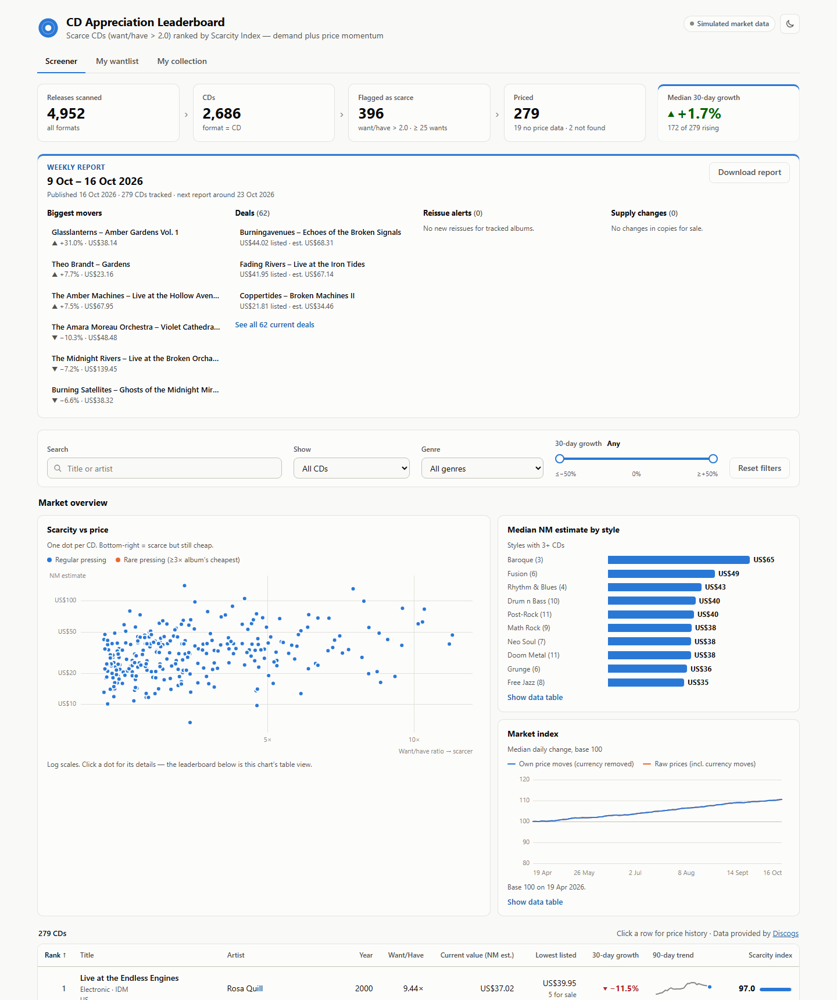
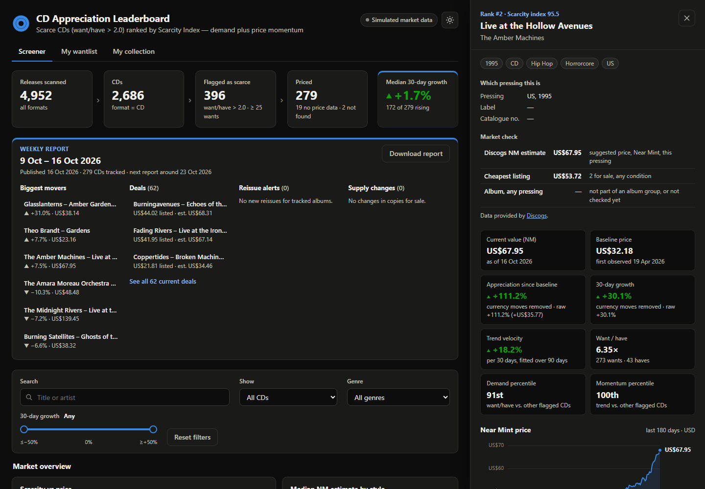

# CD Market Appreciation Screener

A data pipeline and dashboard that finds physical music CDs that are **scarce** (far more
collectors want them than own them) and tracks whether they are **appreciating**, using
live data from the Discogs marketplace API.

> This application uses Discogs' API but is not affiliated with, sponsored or endorsed by
> Discogs. 'Discogs' is a trademark of Zink Media, LLC. Data provided by
> [Discogs](https://www.discogs.com).



*Screenshots are from the built-in demo mode, so every artist, title and price in them is
fictional. Real Discogs prices are kept on my own machine and never published (see
[Discogs data and terms](#discogs-data-and-terms)).*

## Why I built this

I collect CDs, and the market for out-of-print pressings behaves like a small, illiquid
asset market. Prices vary widely between pressings of the same album, many CDs rarely sell,
and listing prices are noisy. I wanted to answer a data question with real data: **can
community demand (want/have) identify CDs before their prices rise?** This repository is
the measurement system for that question. It ingests, cleans and scores the market every
day, so the hypothesis can be tested once enough history exists.

## Early findings (16 Oct 2026: 243 scarce CDs, 2 days of prices)

These compare price *levels* across CDs, which two days of data can support. Claims about
price *changes* wait for a month of history. They are summary statistics only: no
Discogs price data is published in this repository.

- **Scarcity is barely priced in.** The rank correlation between want/have ratio and
  Near Mint estimate is only **0.12**, so scarce CDs are not systematically more expensive.
  That gap is what the screener looks for.
- **Style matters more than scarcity.** Median want/have is similar across styles (2.6–3.8×),
  but the median Near Mint estimate in the most expensive style (City Pop) is **almost 3×**
  that of the cheapest (IDM).
- **Japanese pressings carry a premium.** They make up 37% of the scarce CDs, and their
  median estimate is **about 60% higher** than that of other pressings.
- **Value often belongs to one variant, not the album.** For 68 of 153 CDs, the pressing's
  estimate is at least 3× the album's cheapest copy, and over 50× in the most extreme case.
- **Marketplace estimates are noisy in thin markets.** Where copies are for sale, Discogs'
  estimate is ≥ 1.5× the cheapest listing for 37% of CDs, yet *below* it for 45%.
  90 of the 243 CDs had no copies for sale at all.
- **Exchange rates hide inside the prices.** On day two, 213 of 237 CDs' GBP estimates
  moved, but only 5 moved once shared currency movements were removed. Without that
  correction, "appreciation" would mostly measure exchange rates.

**Next:** test whether the Scarcity Index predicts realised appreciation, once a month
of daily data exists (mid-November 2026).



## What it demonstrates

- **Data engineering:** daily incremental ingestion from a rate-limited REST API. It
  throttles proactively, slows down when the rate-limit headers say to, and backs off
  exponentially with jitter on 429 and 5xx errors. Runs are idempotent and resumable,
  and the SQLite schema (generated columns, in-place migrations) separates facts,
  operational logs and derived snapshots.
- **Analytics (pandas):** as-of joins for 30-day growth, a least-squares log-price trend,
  a percentile-based composite score, detection and removal of shared currency moves,
  and deal and reissue signals.
- **Product:** a Flask JSON API and a dependency-free JavaScript dashboard with
  accessible SVG charts, frozen weekly reports, and a Windows scheduled job with desktop
  notifications.
- **Quality:** 69 automated tests that never touch the network; rate-limit and retry
  behaviour is tested with a fake clock.

```
 Discogs search ──► SQLite ──► funnel filter ──────► rate-limited daily ──► pandas ─────► Flask API + dashboard
 (8 collector       releases   CD, want/have > 2,    price + listing        metrics and   leaderboard, charts,
  styles)                      ≥ 25 wants            checks                 signals       weekly report
 6,776 releases                274 flagged           243 priced
```

Stack: Python 3.10+, SQLite, pandas, requests, Flask, plain HTML/CSS/JS (no Node, no build step).
Licensed under the [MIT License](LICENSE) (the code only; Discogs data is subject to the
[Discogs API Terms of Use](https://support.discogs.com/hc/en-us/articles/360009334593-API-Terms-of-Use)).

---

## Quick start (offline demo, ~1 minute)

Works without a Discogs account: releases and prices come from a built-in simulator that
mimics the Discogs API, including occasional `429 Too Many Requests` responses.

**Windows (PowerShell)**

```powershell
cd cd-appreciation-screener
py -3.12 -m venv .venv                      # skip if .venv already exists
.\.venv\Scripts\python.exe -m pip install -r requirements.txt
.\.venv\Scripts\python.exe -m cd_screener demo
.\.venv\Scripts\python.exe -m cd_screener serve
```

**macOS / Linux**

```bash
cd cd-appreciation-screener
python3 -m venv .venv && source .venv/bin/activate
pip install -r requirements.txt
python -m cd_screener demo
python -m cd_screener serve
```

Open **http://127.0.0.1:5000**. In VS Code you can also use *Ctrl+Shift+P → "Simple Browser: Show"*.

**One-click launcher (Windows):** run `powershell -ExecutionPolicy Bypass -File scripts\create_shortcut.ps1`
once. It adds a **CD Screener** shortcut (with its own icon) to the Desktop and Start menu.
Double-clicking it starts the dashboard and opens it in your browser, and closing the
minimised "CD Screener" window stops it. Pin it to the taskbar from the Start menu entry.

> Prefer an activated shell? On Windows run `.\.venv\Scripts\Activate.ps1` (if PowerShell
> blocks it, run `Set-ExecutionPolicy -Scope CurrentUser RemoteSigned` once), then use
> plain `python -m cd_screener ...`. The examples below assume an activated venv.

---

## The pipeline, step by step

| Command | Stage | What it does |
|---|---|---|
| `python -m cd_screener seed` | 1 · Funnel core | Generates a simulated Discogs data dump (XML), stream-parses it into SQLite, runs the filter `format = 'CD' AND want/have > 2.0` |
| `python -m cd_screener ingest --genre Rock` | 1 · Live alternative | Loads **real** CD releases + want/have counts from the Discogs search API (needs a token) |
| `python -m cd_screener fetch-prices` | 2 · Pricing | Prices the top 300 flagged releases at ≤ 60 req/min and appends to `price_history` |
| `python -m cd_screener analyze` | 3 · Analytics | Computes appreciation metrics + Scarcity Index into `release_metrics` (also runs automatically after `fetch-prices`) |
| `python -m cd_screener serve` | 4 · Dashboard | Starts the web app on http://127.0.0.1:5000 |
| `python -m cd_screener sync-me` | Your Discogs | Syncs your wantlist and collection (the token identifies you, so no username is needed) and records today's prices. Wantlist variants are grouped by album and priced with **one request per album per day**, using Discogs' album-wide cheapest copy (any pressing or format); each album links to its CD-only marketplace listings. The collection is valued with Discogs' own valuation. Runs automatically in the daily job; see the **My wantlist** and **My collection** tabs. |
| `python -m cd_screener report` | Report | Publishes the weekly report now. `fetch-prices` does this automatically once 7 days have passed since the last report ended. The latest report is frozen and shown as a dated card at the top of the dashboard until the next one replaces it, and is also saved as `reports/report-YYYY-MM-DD.md` (biggest movers, deals, reissue alerts, supply changes). |
| `python -m cd_screener demo` | 1→3 | `seed` + 180 days of simulated history + a simulated price run + analytics |

Useful options (`--help` on any command lists them all):

```bash
python -m cd_screener seed --count 20000 --min-ratio 2.5 --min-wants 25
python -m cd_screener fetch-prices --limit 100            # fewer releases
python -m cd_screener fetch-prices --min-wants 50         # stricter funnel (default 25)
python -m cd_screener fetch-prices --ids 249504,1234567  # specific releases
python -m cd_screener fetch-prices --force               # refetch even if priced today
python -m cd_screener fetch-prices --simulate --backfill-days 90
python -m cd_screener --db other.db serve --port 8080
```

---

## Going live with real Discogs data

1. Create a personal access token at <https://www.discogs.com/settings/developers>.
2. Fill in your **seller settings** on Discogs. The price-suggestions endpoint refuses
   requests from accounts without them, and prices come back in your selling currency.
3. `copy .env.example .env` (Windows) or `cp .env.example .env`, then set `DISCOGS_TOKEN`
   and put your contact details in `DISCOGS_USER_AGENT`.
4. Load real candidates, then price them:

   ```bash
   python -m cd_screener ingest --genre Electronic --style IDM --pages 5
   python -m cd_screener ingest --genre Rock --style Shoegaze --pages 5
   python -m cd_screener fetch-prices          # ~5.5 minutes for 300 releases
   ```

   `ingest` removes simulated rows automatically, so synthetic and real data never mix.
   `seed` refuses to overwrite real data unless you pass `--force`.

5. **Run `fetch-prices` once a day.** The API only returns *today's* suggested price, so
   the time series (and the 30-day growth figure) builds up one observation per run.
   On Windows, install the scheduled task. Run this once in a PowerShell window opened with
   **Run as administrator**:

   ```powershell
   powershell -ExecutionPolicy Bypass -File scripts\install_daily_task.ps1
   ```

   It runs `python -m cd_screener daily` hidden at 12:00 every day, or as soon as possible
   afterwards if the PC was off. It shows a Windows notification when it starts and when it
   finishes (CDs priced, deals, new weekly report) and logs to `logs\daily.log`. Extra runs
   on the same day are harmless. Use `-Time "08:30"` for another time, and
   `scripts\uninstall_daily_task.ps1` to remove it.

   On macOS/Linux, use cron: `0 7 * * * cd /path/to/cd-appreciation-screener && .venv/bin/python -m cd_screener fetch-prices`.

**Rate limiting.** Discogs allows 60 authenticated requests per minute per IP. The worker:
- spaces requests ~1.1 s apart (90% of the limit);
- reads the `X-Discogs-Ratelimit-Remaining` header and slows down when it gets low;
- retries `429` and `5xx` responses and network errors with exponential backoff and
  jitter (5 s, 10 s, 20 s, ...), honouring `Retry-After` when the server sends it;
- commits after every release, so you can stop it with Ctrl+C and re-run it. Releases
  already priced today are skipped.

---

## How the numbers are defined

| Metric | Definition |
|---|---|
| Want/Have ratio | `wants / max(haves, 1)`, computed by SQLite as a generated column. The funnel also requires at least 25 wants (`MIN_WANTS`), so "4 wants / 1 have" noise is skipped. |
| Current value (NM est.) | Latest Discogs *price suggestion* for a Near Mint copy of **this exact pressing**. It's an estimate, not a sale price. |
| Lowest listed | Cheapest copy of this pressing for sale right now (any condition) and how many are listed, from `/marketplace/stats` |
| Album, any pressing | Cheapest copy of the album across all pressings and formats, from `/masters/{id}` (refreshed weekly) |
| *Rare pressing* flag | The NM estimate is at least 3× the album's cheapest copy, so the value is tied to this specific variant. Other pressings are much cheaper. |
| *Deal* flag | The cheapest listing is ≥ 20% below this pressing's **usual listing price** (median of the previous 30 days, at least 3 observations), or ≥ 30% below the NM estimate. The second rule compares with an estimate, and listings can be in any condition, so check the copy. Filter with **Show → Deals only**. |
| *Reissue alert* | The number of CD pressings of the album **went up** since tracking started, or the album had a CD pressing released in the last 2 years. Reissues can lower the value of existing pressings. Pressing lists are refreshed every 3 days. |
| Copies for sale chart | Each CD's detail panel tracks how many copies are listed over time. Shrinking supply often comes before price rises. |
| Baseline | Earliest recorded price (same currency) |
| Absolute change | `current − baseline` |
| % appreciation | `(current − baseline) / baseline × 100` |
| 30-day growth | Change vs. the last observation at least 30 days before the latest one, with **shared currency moves removed** (see below). Shown as "—" until there is ~30 days of history. |
| Shared-move removal | Discogs converts each estimate into your account currency daily, so exchange-rate changes move many CDs by exactly the same % on the same day. Each day, a group of identical moves (within 0.05%, at least 4 CDs and 2% of the day's CDs) counts as a currency effect only if it is a statistically significant spike against nearby moves (Poisson test, p < 0.001) and the groups together explain at least 30% of the day's CDs. Grouped CDs count as unchanged and remember who they moved with. When a CD later moves for its own reasons, only its own currency group's move is subtracted. Appreciation, growth and trend use the adjusted prices; the raw figures are shown alongside. |
| Trend velocity | Least-squares slope of `ln(price)` over the last 90 days, expressed as % per 30 days. It uses every point, so it is less noisy than a two-point comparison. |
| Scarcity Index (0–100) | `100 × (0.5 × demand percentile + 0.5 × momentum percentile)`. Demand is the release's want/have rank among priced CDs; momentum is its velocity rank. A release without enough history counts as neutral (50th percentile). |

The leaderboard **Rank** is by Scarcity Index. Weights and windows live in `cd_screener/config.py`.

---

## API

| Endpoint | Returns |
|---|---|
| `GET /api/leaderboard` | Ranked releases. Query: `q` (title/artist search), `genre`, `min_growth`, `max_growth`, `sort` (`rank`, `title`, `artist`, `year`, `ratio`, `price`, `growth`, `appreciation`, `score`), `order` (`asc`/`desc`), `limit` |
| `GET /api/releases/<id>` | One release: metadata, metrics, full price history, last 5 fetch attempts (404 if unknown) |
| `GET /api/summary` | Funnel counts, data mode, missing-price counts, last fetch time |
| `GET /api/genres` | Genres on the leaderboard with counts |

Invalid parameters return `400` with an explanation. A missing or empty database returns
`503` with the command to run.

---

## Project layout

```
cd-appreciation-screener/
├── cd_screener/
│   ├── __main__.py         CLI: seed / ingest / fetch-prices / analyze / serve / demo
│   ├── config.py           all thresholds, limits and paths (+ .env loading)
│   ├── schema.sql          SQLite schema
│   ├── db.py               connections, funnel query, write helpers
│   ├── seed.py             stage 1: simulated Discogs dump -> streaming parser -> funnel
│   ├── ingest.py           stage 1 (live): real releases from Discogs search
│   ├── discogs_client.py   stage 2: HTTP client, rate limiter, retries/backoff
│   ├── simulated_market.py offline stand-in for the Discogs marketplace
│   ├── price_worker.py     stage 2: the pricing worker
│   ├── analytics.py        stage 3: pandas metrics + Scarcity Index
│   ├── app.py              stage 4: Flask JSON API
│   └── static/             dashboard: index.html, styles.css, app.js
├── tests/                  pytest suite (no network access needed)
├── data/                   SQLite database + simulated dump (created on first run)
├── requirements.txt / requirements-dev.txt
└── .env.example
```

**Tables:** `releases` (metadata, pressing details and want/have), `price_history`
(append-only NM estimates), `listing_history` (cheapest listing and copies for sale per
run), `master_snapshots` (album-wide cheapest copy), `fetch_log` (every fetch attempt and
its outcome), `release_metrics` (latest analytics snapshot, rebuilt by every `analyze`).
Older databases are upgraded automatically.

Each daily `fetch-prices` run makes two requests per CD (estimate and listing) plus one per
album once a week, so pricing 300 CDs takes about 10–12 minutes.

---

## Tests

```bash
pip install -r requirements-dev.txt
python -m pytest
```

The tests run against temporary databases and fake HTTP sessions with a fake clock, so
they never touch the network or actually wait out a rate limit.

---

## Discogs data and terms

This is a **personal, non-commercial project**: nothing is sold, no fee is charged, and
no data is shared. It uses the Discogs API under the
[Discogs API Terms of Use](https://support.discogs.com/hc/en-us/articles/360009334593-API-Terms-of-Use).
Discogs classifies marketplace data (price suggestions, listings, sales history) and user
data (usernames, wantlists, collections) as **Restricted Data**. It may not be transferred
to third parties, or displayed once it is more than six hours older than the information
on Discogs. So:

- **Published here:** the code, tests, documentation and demo screenshots (fictional data).
- **Never published:** the database (prices, listings, wantlist, collection), the weekly
  reports and the logs. They are git-ignored and stay on the machine that runs the tool.
- **Attribution:** the dashboard and reports show the required notice and
  "Data provided by Discogs", with links back to the relevant Discogs pages.
- **Price history:** keeping a history of prices for analysis is a grey area in the terms
  ("You may not cache or store the Content longer than is necessary to provide a service
  to Your application's users"). The tool therefore runs privately, and a public live
  version would only be built with Discogs' permission.

This application uses Discogs' API but is not affiliated with, sponsored or endorsed by
Discogs. 'Discogs' is a trademark of Zink Media, LLC.

---

## Notes and limitations

- **Demo mode uses fictional data.** The offline `demo` and `seed` commands generate
  made-up artists, titles and prices, so the project runs without a Discogs account. The
  findings above come from live Discogs data. Simulated release IDs start at 90,000,001,
  and the live worker refuses to send them to Discogs.
- **"Median" vs. price suggestion.** The Discogs website shows a sales-history median,
  but the public API does not expose it. The closest condition-specific figure it offers
  is the *price suggestion* for each grade, which is based on past sales. This app tracks
  the Near Mint suggestion.
- **Want/have in the data dumps.** Discogs' monthly XML dumps don't include community
  want/have counts. The simulator adds them to its synthetic dump. For real data,
  `ingest` reads them from the search API.
- **Pre-2020 SQLite.** The schema uses a generated column, which needs SQLite 3.31 or
  newer (bundled with every current Python).

---

## Acknowledgements

This project was built with the help of [Claude](https://www.anthropic.com/claude),
Anthropic's AI assistant, using Claude Code. I came up with the idea and directed the
project: what to build and in what order, the requirements, and the decisions along the
way, such as keeping Discogs price data private and removing currency effects from
prices. I also tested it against my own Discogs data. Claude wrote most of the code,
tests and documentation based on that direction.
